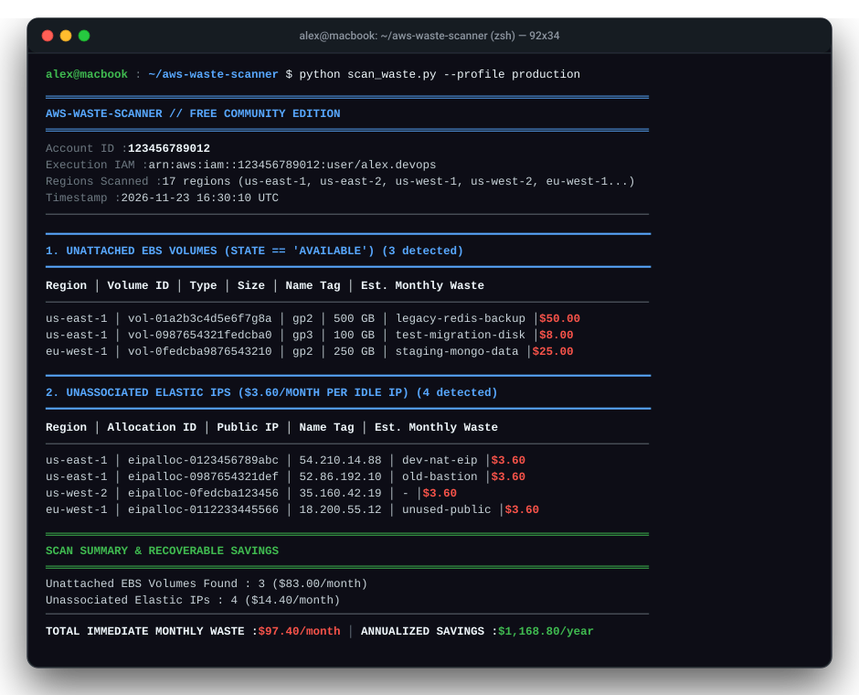

# 🔍 aws-waste-scanner (Free Edition)
### *A Lightweight, Strictly Read-Only CLI to Spot Low-Hanging AWS Cloud Waste in 60 Seconds*

[](https://www.python.org/downloads/)
[](https://boto3.amazonaws.com/v1/documentation/api/latest/index.html)
[](https://opensource.org/licenses/MIT)
[](#-security--minimum-read-only-iam-policy)

<p align="center">
  
</p>

---

> ### 🚀 Looking for the Complete AWS FinOps Toolkit?
> **`aws-waste-scanner`** is the free community edition that audits unattached EBS volumes and idle Elastic IPs.
> 
> Need the complete solution? Check out **[The Production AWS Cost-Optimization Playbook & FinOps Kit](https://yourhandle.gumroad.com/l/aws-cost-optimization-kit)**:
> - **Full 5-Service Waste Auditor:** Adds live `gp2` $\to$ `gp3` migration savings math (20%), uncapped CloudWatch logs auditing, and running non-prod EC2/RDS detection.
> - **Turnkey Terraform Guardrails:** Pre-built AWS Budgets (actual + forecast) and Cost Anomaly Detection ($25/20% daily threshold).
> - **Automated Off-Hours Scheduler:** Python 3.12 Lambda + EventBridge cron that shuts down non-prod workloads on nights/weekends (~65% compute savings).
> - **25-Page Engineering Field Manual:** Real CLI commands, NAT Gateway VPC Endpoint bypass guides, and S3 multipart cleanup scripts.
> 
> 🎁 **GitHub Launch Discount:** Use code **`FIRST10`** at checkout for **40% OFF** the full Pro Kit.  
> 👉 **[Claim 40% Off The Production FinOps Kit](https://yourhandle.gumroad.com/l/aws-cost-optimization-kit?discount_code=FIRST10)**

---

## What is `aws-waste-scanner`?

`aws-waste-scanner` is a zero-dependency (other than `boto3`), multi-region CLI tool that inspects your AWS account for the two most common "silent money pits" left behind after instance termination:

1. **Unattached EBS Volumes (`state == 'available'`):** Storage volumes detached from terminated EC2 instances that continue incurring full monthly gigabyte fees ($0.10/GB for `gp2`, $0.08/GB for `gp3`).
2. **Unassociated Elastic IPs (Missing `AssociationId`):** Public IPv4 allocations sitting idle in your VPC, billed at AWS's standard **$0.005/hour ($3.60/month per IP)** idle surcharge.

It executes in **under 30 seconds**, makes **zero changes** to your infrastructure, and prints a crisp terminal summary showing your immediate recoverable waste in dollars.

---

## 🖥️ Sample Terminal Output

```text
========================================================================================
   AWS-WASTE-SCANNER // FREE COMMUNITY EDITION
========================================================================================
 Account ID      : 123456789012
 Execution IAM   : arn:aws:iam::123456789012:user/alex.devops
 Regions Scanned : 17 regions (us-east-1, us-east-2, us-west-1, us-west-2, eu-west-1...)
 Timestamp       : 2026-11-23 12:45:10 UTC
────────────────────────────────────────────────────────────────────────────────────────

━━━━━━━━━━━━━━━━━━━━━━━━━━━━━━━━━━━━━━━━━━━━━━━━━━━━━━━━━━━━━━━━━━━━━━━━━━━━━━━━━━━━━━━━
 1. UNATTACHED EBS VOLUMES (STATE == 'AVAILABLE') (3 detected)
━━━━━━━━━━━━━━━━━━━━━━━━━━━━━━━━━━━━━━━━━━━━━━━━━━━━━━━━━━━━━━━━━━━━━━━━━━━━━━━━━━━━━━━━
 Region    │ Volume ID             │ Type │ Size   │ Name Tag             │ Est. Monthly Waste
────────────────────────────────────────────────────────────────────────────────────────
 us-east-1 │ vol-01a2b3c4d5e6f7g8a │ gp2  │ 500 GB │ legacy-redis-backup  │ $50.00
 us-east-1 │ vol-0987654321fedcba0 │ gp3  │ 100 GB │ test-migration-disk  │ $8.00
 eu-west-1 │ vol-0fedcba9876543210 │ gp2  │ 250 GB │ staging-mongo-data   │ $25.00

━━━━━━━━━━━━━━━━━━━━━━━━━━━━━━━━━━━━━━━━━━━━━━━━━━━━━━━━━━━━━━━━━━━━━━━━━━━━━━━━━━━━━━━━
 2. UNASSOCIATED ELASTIC IPS ($3.60/MONTH PER IDLE IP) (4 detected)
━━━━━━━━━━━━━━━━━━━━━━━━━━━━━━━━━━━━━━━━━━━━━━━━━━━━━━━━━━━━━━━━━━━━━━━━━━━━━━━━━━━━━━━━
 Region    │ Allocation ID            │ Public IP       │ Name Tag       │ Est. Monthly Waste
────────────────────────────────────────────────────────────────────────────────────────
 us-east-1 │ eipalloc-0123456789abc   │ 54.210.14.88    │ dev-nat-eip    │ $3.60
 us-east-1 │ eipalloc-0987654321def   │ 52.86.192.10    │ old-bastion    │ $3.60
 us-west-2 │ eipalloc-0fedcba123456   │ 35.160.42.19    │ -              │ $3.60
 eu-west-1 │ eipalloc-0112233445566   │ 18.200.55.12    │ unused-public  │ $3.60

========================================================================================
 SCAN SUMMARY & RECOVERABLE SAVINGS
========================================================================================
 Unattached EBS Volumes Found :    3  ($83.00/month)
 Unassociated Elastic IPs     :    4  ($14.40/month)
────────────────────────────────────────────────────────────────────────────────────────
 TOTAL IMMEDIATE MONTHLY WASTE : $97.40/month
 PROJECTED ANNUALIZED SAVINGS  : $1,168.80/year
========================================================================================

💡 FINOPS PRO-TIP:
   This free tool only scans 2 surface-level waste vectors (Unattached EBS & Idle EIPs).
   The full Production AWS Cost-Optimization Kit also audits:
   • Active gp2 volumes eligible for zero-downtime gp3 upgrade (exact 20% savings)
   • CloudWatch Log Groups set to 'Never Expire' hoarding unindexed bytes
   • Running non-prod EC2 & RDS instances missing an Environment=prod tag
   • Complete Terraform guardrails (AWS Budgets, Anomaly Detection & Off-Hours Auto-Stop)
   • 25-Page Field Manual + 20-Point Monthly FinOps Checklist (CSV)

   👉 Get the Full Kit: https://yourhandle.gumroad.com/l/aws-cost-optimization-kit
```

---

## ⚡ 60-Second Quickstart

### Prerequisites
- Python 3.9+
- AWS credentials configured (`~/.aws/credentials` or AWS environment variables)

### Installation & Run

```bash
# 1. Clone the repository
git clone https://github.com/yourusername/aws-waste-scanner.git
cd aws-waste-scanner

# 2. Install dependencies (just boto3)
pip install -r requirements.txt

# 3. Run the scan with your default AWS profile
python scan_waste.py

# Or target a specific named profile or subset of regions:
python scan_waste.py --profile production --regions us-east-1,us-west-2
```

---

## 🔒 Security & Minimum Read-Only IAM Policy

Security first: `aws-waste-scanner` **never modifies, terminates, or touches your infrastructure**. It only calls `Describe*` endpoints.

Attach this least-privilege IAM policy to your IAM user or role to run the scanner safely:

```json
{
  "Version": "2012-10-17",
  "Statement": [
    {
      "Sid": "AllowWasteScannerReadOnly",
      "Effect": "Allow",
      "Action": [
        "ec2:DescribeRegions",
        "ec2:DescribeVolumes",
        "ec2:DescribeAddresses"
      ],
      "Resource": "*"
    }
  ]
}
```

---

## 📊 Free vs. Pro Edition Comparison

| Feature / Capability | `aws-waste-scanner` (Free) | [Production FinOps Kit (Pro)](https://yourhandle.gumroad.com/l/aws-cost-optimization-kit) |
| :--- | :---: | :---: |
| **Unattached EBS Volume Audit** | ✅ Yes | ✅ Yes |
| **Unassociated Elastic IP Audit** | ✅ Yes | ✅ Yes |
| **Active gp2 $\to$ gp3 Live Migration Audit** (20% Savings) | ❌ No | ✅ **Yes** |
| **CloudWatch Log Group "Never Expire" Audit** | ❌ No | ✅ **Yes** |
| **Running Non-Prod EC2 & RDS Instance Audit** | ❌ No | ✅ **Yes** |
| **Timestamped CSV Report Export** | ❌ No | ✅ **Yes** |
| **AWS Budgets & Cost Anomaly Terraform Modules** | ❌ No | ✅ **Yes** |
| **Automated EventBridge + Lambda Off-Hours Scheduler** | ❌ No | ✅ **Yes** |
| **25-Page Technical Field Manual (Zero-Downtime Fixes)** | ❌ No | ✅ **Yes** |
| **20-Point Monthly FinOps Checklist Tracker (CSV)** | ❌ No | ✅ **Yes** |
| **Commercial Team License** | Open Source (MIT) | **Single Team / Commercial** |
| **Price** | **FREE** | **$29** *(or $17.40 with code)* |

---

## 🎁 Upgrade to the Full Kit (40% Launch Discount)

Ready to tackle the other 80% of your AWS waste?

Get **The Production AWS Cost-Optimization Playbook & FinOps Kit** with ready-to-deploy Terraform guardrails, the complete 5-service multi-region Python auditor, and the 25-page playbook.

1. Head over to **[The Production AWS Cost-Optimization Kit on Gumroad](https://yourhandle.gumroad.com/l/aws-cost-optimization-kit)**.
2. Enter discount code **`FIRST10`** at checkout.
3. Save **40% instantly** on your copy.

---

## 📄 License

This free community edition is open-source under the [MIT License](LICENSE).
Feel free to use it in internal scripts or contribute improvements via PRs!
